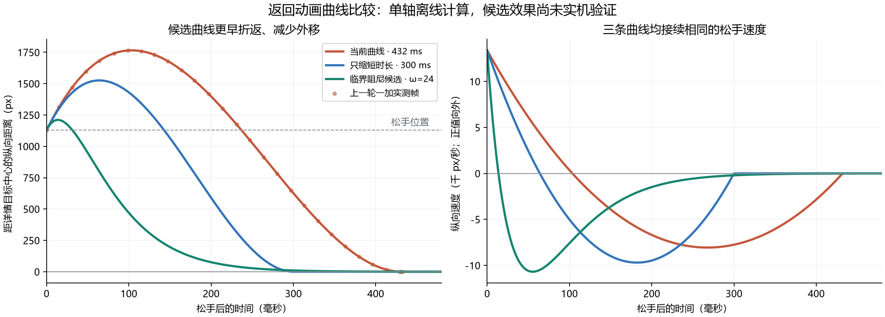

# 返回动画的惯性距离与速度曲线调研

## 请求与结论

用户体验 debug `202610220932` 后反馈惯性外移偏大、收回略慢，要求上网调研贝塞尔曲线是否适用。本轮完成官方资料、平台实现及三机已存轨迹的离线比较，尚未修改应用或发布新包。

没有必须遵循的单一贝塞尔曲线。当前实现已经是三次 Hermite 曲线，可精确改写为三次贝塞尔；主要问题是惯性量与整段 432 ms 时长绑定，较大的初速度会产生很长的外移。建议优先比较接续初速度的临界／接近临界阻尼弹簧，让外移更短、折返更早，同时控制尾段。直接换固定缓入缓出曲线会丢掉当前速度，不能作为修复。

## 官方资料与工程实践

| 来源 | 对本场景的启示 |
| --- | --- |
| [Android：弹簧动画](https://developer.android.com/develop/ui/views/animations/spring-animation) | 弹簧同时计算位置和速度，可设置初速度、刚度、阻尼及目标；单向摩擦甩动与回到目标是不同任务。当前 View 架构即可实现。 |
| [Apple WWDC23：Animate with springs](https://developer.apple.com/videos/play/wwdc2023/10158/) | 固定缓入缓出在手势结束处会忽然停住；弹簧适合承接速度。主体到达与数学上完全停稳要分开，不能把长尾全部变成用户等待。 |
| [Apple WWDC18：Designing Fluid Interfaces](https://developer.apple.com/videos/play/wwdc2018/803/) | 建议从无过冲开始调试；Music 的手势关闭使用少量弹性来响应动量。其 80% 阻尼是产品实例，不是通用规范。 |
| [Material 3：Motion physics system](https://m3.material.io/styles/motion) | 2025 年引入的运动体系采用弹簧，按表达程度和用途配置；并不要求所有交互使用一条固定的时间插值曲线。页面正文依赖 JavaScript，本轮使用官方页面的搜索索引正文核对。 |
| [AOSP Launcher3：RectFSpringAnim，固定提交 18c53ac26b](https://android.googlesource.com/platform/packages/apps/Launcher3/+/18c53ac26b/quickstep/src/com/android/quickstep/util/RectFSpringAnim.java) | 矩形位置采用 FlingSpringAnim，尺寸另设弹簧；输入速度经过软化，避免轨迹偏离过大。说明“承接手势”还需要处理极端速度，不能只照搬输入值。该提交是工程参考，不代表所有 Android 版本的实现。 |

资料中的弹簧建议不意味着动态贝塞尔不能保持速度：按本次初速度计算控制点也能做到。AOSP 在松手时软化速度则属于工程折中，不等于严格保持原始速度的一阶连续。

## 当前实现与可检验解释

`MediaPreviewReturnMotion.position` 的标量位置为：

```text
s = t / T，T = 0.432 秒
x(t) = x0 + (x1 - x0) × (3s² - 2s³) + v0 × T × s(1-s)²
```

它与控制点 `P0=x0`、`P1=x0+v0×T/3`、`P2=x1`、`P3=x1` 的三次贝塞尔完全等价。时间参数为线性 `s`；若写成归一化的时间—进度曲线，在 `x1≠x0` 时是 `cubic-bezier(1/3, v0×T/[3(x1-x0)], 2/3, 1)`。初速度为 `v0`，末速度为零，但中途外移没有独立的上限。

1. **整段时长放大外移。** 惯性项直接乘以 `T`，快甩速度在当前路径中没有按该场景进一步控制。缩短时长应同时减少外移；下面的离线比较证实了这一点。
2. **换成固定缓入缓出即可改善。** 不成立：固定曲线无法同时匹配不同松手速度；当前已经支持非零初速度，不能以新的起步停顿换取更小外移。
3. **任何弹簧都会更快结束。** 不成立：较软弹簧虽提前完成主要位移，收尾仍可能比当前更长。必须分别比较主体位移、末端误差和速度，不能只比较“到达 95%”。
4. **末端窗口交接也可能影响慢的感受。** 当前运动后仍有详情准备和 96 ms 遮层淡出。代码证明该阶段存在，但本轮没有新增端到端实测，不能把主观慢全部归因于它。

## 用已保存的真实轨迹比较

从三星、一加、魅族最终有效夹具报告各取一次快速下甩，使用全部中间帧反推当前模型的初速度。曲线重建最大误差小于 0.0003 px，说明以下计算确实对应当前路径。三机当前模型外移峰值约 605–670 px，转向在 98–104 ms。

以下以一加为例：松手中心 `1583.9446 px`，详情目标中心 `456 px`，反推初速度 `13375.58 px/s`。各候选保持完全相同的起点、目标和初速度，仅改运动模型；步长 0.1 ms。

| 曲线 | 额外向外位移 | 开始折返 | 位置误差 ≤5% | 位置误差 ≤1% | 位置误差 ≤2 px |
| --- | ---: | ---: | ---: | ---: | ---: |
| 当前 Hermite，432 ms | 637 px | 104 ms | 397 ms | 417 ms | 426 ms |
| 只缩短到 300 ms | 398 px | 64 ms | 273 ms | 288 ms | 295 ms |
| 临界阻尼弹簧，ω=20 | 110 px | 19 ms | 262 ms | 356 ms | 454 ms |
| 临界阻尼弹簧，ω=24 | 83 px | 14 ms | 215 ms | 294 ms | 375 ms |

百分比以松手位置到目标的距离为分母，数值是进入后持续保持在对应误差内的时刻。**这些只是纵向中心的位置指标，不代表速度归零、缩放完成或窗口可交互；候选尚未实机验证。** 原始逐帧采样的一加外移为 636 px，连续模型峰值为 637 px，差异来自采样时刻。未用未知屏幕密度将 px 换算成 dp。

临界阻尼模型使用质量 1、阻尼比 1，`ω=√刚度`；两组刚度为 400 和 576。这些是本轮对照参数，不是官方推荐值。对本例的向外速度，临界阻尼仍先向外延续，再收回目标，不需要在终点加入反复振荡。



[计算脚本](checks/compare-return-curves.py)、[三机结果与输入 SHA-256](checks/return-curve-comparison-2026-10-22.json)。输入是上一轮 `tmp/` 下保留的原始报告，脚本不连接设备；复现时需要保留这些输入。脚本内临界阻尼公式为 `x=x1+[D+(v0+ωD)t]exp(-ωt)`，`D=x0-x1`。

## 建议的调整与验证

- 优先试接续原始速度的临界阻尼弹簧，随后根据实机观感决定是否需要很轻的欠阻尼。这里期望的是松手方向上的短距离延续，不是到详情位置后反复弹跳；不能把“弹簧”等同于更多回弹。
- 先比较主体回收到约 300 ms 附近的候选。表中 ω=24 的外移明显更短，属于值得实机对照的起点，不预先认定它就是最佳手感。上滑、下滑、慢拖、快甩、不同目标距离和刷新率均须核对。
- 外移边界按 dp 或可用视口比例定义；选择参数时同时约束峰值和回收时间。仅使用一个固定弹簧仍不能保证任意初速度下的外移上限，应针对高速输入调整制动力／刚度。避免到边界硬截位置或松手时直接把速度乘常数，否则会产生速度突变。
- 保留当前位置、速度及等比缩放的连续性；位置与尺寸可分别调节响应，黑底和裁剪仍需协调。采用弹簧后，不应让背景／裁剪继续被旧的 432 ms 时钟拖住。
- 用位置和速度共同判断末端可见变化，并验证详情端点交接。不能在距离目标仍有明显误差时强行跳到终点，也不能单纯为了等数学尾部而阻塞下一次操作。
- 新增回归指标：外移峰值、折返时刻、到达 95%／99% 的时间、末端位置／速度、实际恢复交互时间；继续保留首运动帧时延、纵横比、播放、HDR、取消保倍率与空间模式规则。当前测试检查了有惯性和端点，但没有外移上限与回收时间门槛，因而未覆盖这次反馈。

本轮结论是调参依据，尚未采纳候选参数、修改生产代码、构建或发布。
