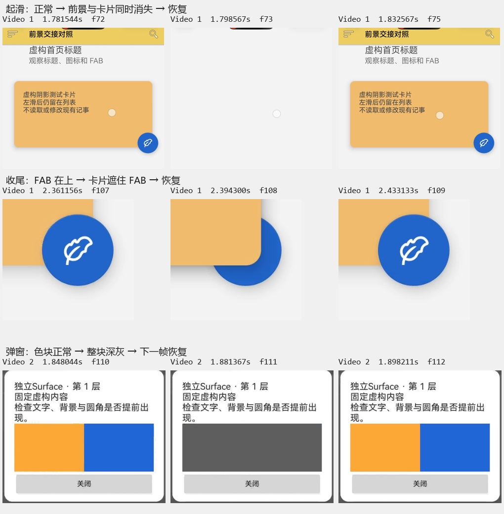

# 卓易通第三轮：视频回归反馈

补充进展：用户已提供同轮 ZIP 并授权三台原生设备回归。恢复遮盖实际未执行，前景提前关闭得到日志支持；两台在线设备完成旧包／第三轮包初步对照。以后以 [ZIP 分析与原生验证](droitong-handoff-zip-feedback-2026-10-11.md) 为最新状态，以下“待 ZIP”是收到附件前的分析记录。

用户在 debug `202610111028` 发布后明确反馈“两项问题没有解决，而且效果更差”，并提供两段 MP4。第三轮候选视为未通过，不能继续写为等待首次验收；以下逐帧分析只针对录像可见范围。

## 输入

- `e48f8584ed0eb29d1b31b99e56868664.mp4`：1,232,142 字节，1136×1920，119 帧；SHA-256 `6c0bdc505785c645a7493dcf58b148d710671884cc2371c06dc11403253f64e3`。
- `3d7ec24576a6c9ea215d28e3ea99774f.mp4`：3,388,488 字节，1136×1920，192 帧；SHA-256 `503e6c1d6ea54c9444f4f7eabcac6bbc36bea335c80ee2dcb7210bdd90416614`。
- 原视频位于用户提供的微信临时目录。离线解码并按实际时间戳检查；录屏帧率不代表应用实际渲染帧率。

## 当前状态

已解码 311 帧，按实际 PTS 检查概览、起滑、收尾和色块恢复的相邻帧。两段画面都显示“本轮两项修复／额外隐藏普通内容”；弹窗运行编号为 `20261011-183521-264`。第三轮退步已经由录像确认，当前不能继续推广。此轮仅分析和更新证据，不修改应用代码、不构建发布，不使用 ADB。

## 录像中的确定现象

帧号从 0 开始。时间为文件实际时间戳；可变帧率录像保留的帧数和持续时间不能换算为应用实际渲染帧率。

| 场景 | 视频时间／帧 | 直接观察 |
| --- | --- | --- |
| 卡片起滑 | 1.798567、1.815311 秒，f73、f74 | 顶栏、标题、副标题、卡片、FAB 同时消失，背景、触点与底部返回按钮还在；1.832567 秒 f75 恢复。录像中空档约 34 毫秒。 |
| 卡片收尾 | 2.394300 秒，f108 | 卡片右下角覆盖 FAB 的左上部分，白色图标也被遮挡；2.433133 秒 f109 恢复 FAB 在卡片上方。发生了遮挡顺序变化，不只是阴影浓度变化。 |
| 独立 Surface 恢复 | 1.881367 秒，f111 | 面板已经完整，只有整个橙蓝矩形变成深灰；1.898211 秒 f112 恢复颜色。录像中灰区约 17 毫秒。 |

色块内部两个采样区域在 f111 均为平均 RGB `(94,94,94)`，窗外暗背景约 `(93.56,93.56,93.56)`；白色面板仍为 `(255,255,255)`。这支持“独立 Surface 区域短暂露出下层背景”的解释，不能解释为橙蓝纹理只被乘了较小 alpha。具体是表面未参与合成、透明区域先更新还是遮盖先撤，录像本身尚不能区分。数值和索引见 [证据 JSON](diagnostics/droitong-2026-10-11/handoff-video-evidence.json)。

另外核对了起滑前、粒子播放及收尾的副标题样本，深色字心众数均约 RGB 111，本段未量出字幕整体叠深至约 60 的状态；不能因此否定用户此前报告，但本段主要退步是整组不可见和遮挡顺序错误，不能继续统一按 alpha 浓度处理。

## 对照代码的判断

1. **收尾过早移除 GL 前景，明确存在顺序风险。** `ParticleGlCardHandoff.finishReturn()` 的 `restoreOnce` 先请求共享 SurfaceView 的 alpha 为 0，随即对前景调用 `release(..., synchronizedGlRestore=true)`；该分支立即 `closeNow()`，经 `ParticleWindowSurface.closeGlLayer()` 将前景 `closed=true` 并触发 GL 重画。此时卡片 GL 层要等窗口提交回调后的 `dispose()` 才关闭。因而确实允许出现“GL 卡片仍可绘制、GL FAB 已撤下”的中间状态，窗口同步没有把 GL 内容清理一起保护起来。f108 的卡片盖住 FAB 与这个风险吻合；需同次日志才能确认为该帧的具体触发顺序。
2. **起滑的跨表面可见性切换没有达到屏幕连续性要求，高优先级。** `gl_show_native_hide` 同一 UI 操作里隐藏原 View、恢复 SurfaceView alpha，但 f73／f74 仍出现两份内容都看不到。不能因 Java 属性已设为 0／1、事务回调返回就判定最终显示切换成功。还需要区分 Surface alpha 更新未同步、所等的缓冲不是最终将显示的静态帧，或异常收尾；暂不直接归咎于卓易通实现。
3. **独立 Surface 的撤盖条件仍弱于显示条件，高优先级。** `ParticleSurfaceRecovery` 用宿主 committed 加源 Surface 的 PixelCopy 颜色通过来撤盖，这能证明生产者有有效缓冲，不能证明该 Surface 已与 Dialog 的透明区域在屏幕上同时恢复。f111 证明这次保护没有覆盖住实际空档；也可能走了未创建覆盖、几何变化或异常分支，待日志区分。
4. **固定混合公式、粒子颜色和大量降低 alpha 均不是本轮优先方向。** 色块前后完整正常，中间均匀变为下层灰；卡片同一时刻整组消失、末尾出现前后顺序变化。这些现象应先查交接，不能通过改阴影浓度、增加固定延迟或更换粒子模型掩盖。

前两项的预测：若只撤回整张 SurfaceView 的 alpha 切换，新出现的全组空白应减少；若 GL 前景与静态卡片作为完整一帧共同保留、共同撤除，收尾时 FAB 被卡片覆盖的中间状态应被排除。第三项的预测：若源缓冲检查正常而屏幕仍灰，日志将显示成功检查后撤盖，问题转向最终合成而非色块生产者没画出颜色。上述是待验证预测，不是已修复结论。

## 对上一轮验证的修正

- 原 40 项测试主要覆盖状态机、重复回调、捕获选择和既有 UI 契约；没有覆盖宿主与 GL 两个线程之间的实际帧交换。
- 桌面着色器脚本预先给定理想的互斥可见状态，再证明颜色合成正确；它没有证明 Android 会按这些状态顺序上屏。因此不能用那 8 项通过推导本次交接已经可靠。这是上一轮验证覆盖不足。
- 官方 [事务 committed 文档](https://developer.android.com/reference/android/view/SurfaceControl.Transaction) 将 committed 描述为已应用、准备呈现；[PixelCopy 文档](https://developer.android.com/reference/android/view/PixelCopy) 明确复制最近入队缓冲。二者均不能单独充当最终画面证明。
- API 35 的 completed 回调及 [present fence](https://developer.android.com/reference/android/view/SurfaceControl.TransactionStats) 可作为后续补证方向；不支持 fence 时会返回空 fence，且卓易通中的实际能力仍须验证。不能简单替换一个回调名便再宣称解决。

## 下一步

- 当前包先使用“上一版 GL 组合／额外隐藏普通内容”作为较稳定的已知对照，无需重新安装旧 APK；本轮组合列为失败候选，保留 SurfaceView 及上一轮有效的 GL 前景、Dialog 内容隐藏。
- 需要这两次已有测试的诊断 ZIP，重点对齐起滑／收尾的 `window_switch_*`、`gl_buffer_committed`、`foreground_closed`、`gl_layer_closed`，以及弹窗的 `surface_recovery_*`、`color_surface_*`；不用先重复录屏。仅从视频还不能知道覆盖是否建立、按哪个分支撤掉，或是否触发超时。
- 后续先消除明确存在的提前关闭 GL 前景问题，并保证每个对外可见的 GL 缓冲中卡片与前景完整，再评估首尾交接。新增验证应包含两个提交队列可任意先后的中间状态，而非只测理想顺序。
- 独立 Surface 则先确认实际撤盖路径；不要继续扩大同类同步层、强制多等几帧，或把整个问题归为 SurfaceView 不可用。
